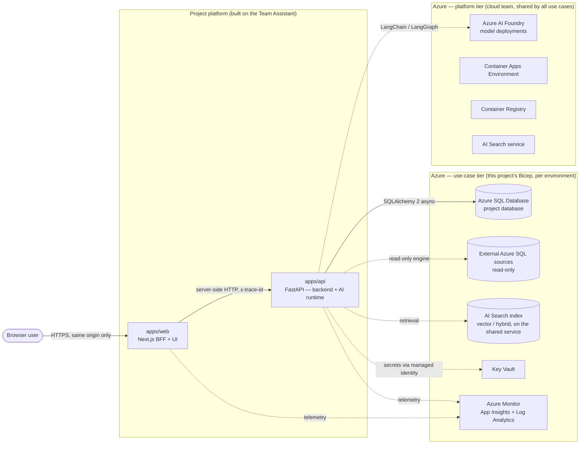
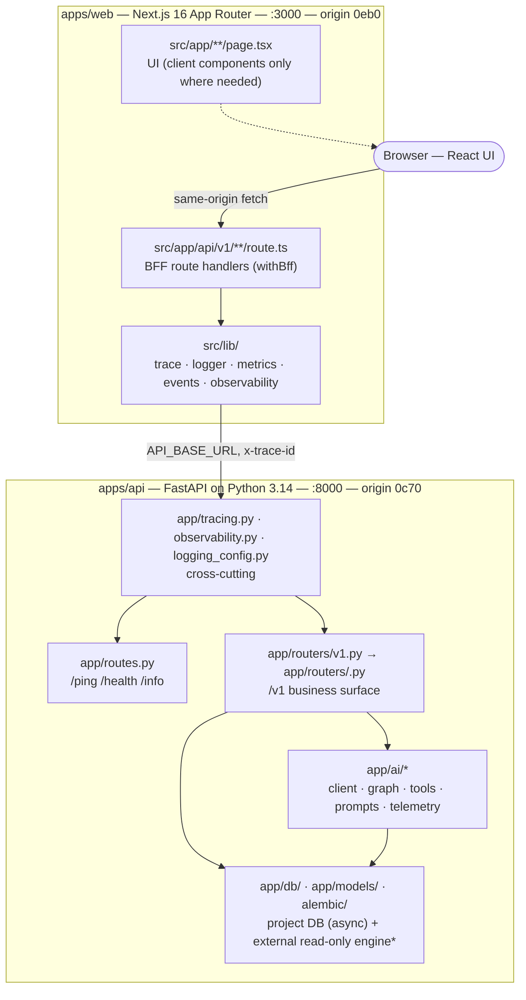

# Architecture — living document

This is the **one architecture file** for a project built on the Team Assistant. It has two
parts with different owners:

| Part                                                               | Owner                                                                  | Rule                                                                                                                                                                                                                                       |
| ------------------------------------------------------------------ | ---------------------------------------------------------------------- | ------------------------------------------------------------------------------------------------------------------------------------------------------------------------------------------------------------------------------------------ |
| **[Part A — Template baseline](#part-a--template-baseline)**       | The template (Orion Digital Solutions for the Diriyah Company AI team) | **Template-owned. Do not edit in a project.** It changes only when the template itself changes (a template release, recorded in [`docs/template-roadmap.md`](../template-roadmap.md)). Every project architecture is built _on top of_ it. |
| **[Part B — Project architecture](#part-b--project-architecture)** | The project team (admin + developers)                                  | **Team-maintained, by hand.** Claude and the `.claude/` skills **read** it before planning and may **propose** edits as a diff or a `Proposed` ADR — they never rewrite it on their own (ADR-0006).                                        |

If anything here disagrees with the code, **the code wins** — then fix this file (root
`CLAUDE.md`, rule 14). Deep-dives behind Part A: [overview.md](overview.md),
[tracing.md](tracing.md), [observability.md](observability.md), [data.md](data.md).

---

## Part A — Template baseline

> Template-owned. A project does not edit this part.

### A1. What the baseline is

A **use-case-agnostic accelerator** for AI applications on Azure: two independent services
wired with end-to-end request tracing and Azure Monitor observability, a database layer ready
for real models, and a `.claude/` toolkit (rules, agents, skills) so that most of the code is
written by Claude under human approval. It ships **plumbing, not product**: no business
domain, no auth, no AI feature — those are the project's job, built in the slots below.

### A2. Principles (non-negotiable in every project)

1. **One inbound edge.** The browser talks only to `apps/web` (the BFF). Service URLs and
   secrets are server-side only; never `NEXT_PUBLIC_*`.
2. **One backend.** `apps/api` (FastAPI) is the sole backend and the sole owner of data access
   and of the AI runtime. `web` is a pass-through BFF plus UI.
3. **One trace id.** `x-trace-id` = origin(4 hex) + env(1 hex) + random(27 hex); minted at the
   edge, forwarded unchanged on every hop, echoed on every response, present on every log line
   and span attribute. Origins: `web=0eb0`, `api=0c70` (`0a71` retired).
4. **Observability is fail-safe and always on.** OpenTelemetry → Azure Monitor; without a
   connection string the services still run (degraded mode, visible on `/health`). Structured
   JSON logs only; secrets redacted at source; bounded metric attributes.
5. **Every business endpoint is versioned** under `/v1` (ADR-0001). Only `/ping`, `/health`,
   `/info` are exempt.
6. **Databases are Azure SQL, on Azure — never locally.** A project's own database is
   **created by infrastructure first**, then modelled (SQLAlchemy 2 async) and migrated
   (Alembic). Migrations are applied by a gated pipeline job or a named human, never by an
   agent. External databases are accessed **read-only** through a separate engine
   (`app/db/external.py`). Driver: `mssql+aioodbc` on ODBC Driver 18, managed-identity auth when
   deployed (ADR-0008).
7. **Infrastructure is Bicep, in two tiers (ADR-0012).** The **platform tier** — Azure AI
   Foundry with its model deployments, the Container Apps Environment, the Container Registry
   and the AI Search service — pre-exists per environment, is owned by the cloud team and is
   **shared by every use case**; the template only references it (`existing`, names from
   `infra/platform/<env>.json`). The **use-case tier** — this project's container apps,
   database, storage, Key Vault, Application Insights, Search index — is `infra/main.bicep`
   composed from the infra team's **vendored building blocks** (`infra/modules/`, never edited
   here) with names per environment in `main.<env>.bicepparam`. GitHub Actions runs `what-if`
   on PR and deploys on merge in every environment; developers may deploy locally to `dev`.
   Roles a use case needs on shared resources are **requested** (`infra/grant-request.md`),
   never assigned here. Agents may `bicep build`/`lint`; they never deploy.
8. **Tests, docs, and telemetry ship with the change** — a feature without them is not done
   (root `CLAUDE.md` → _Definition of Done_).
9. **Decisions are recorded** as ADRs in `docs/adr/`; the team's design inputs live in
   `docs/design/`; the plan of record lives in `roadmaps/`.

### A3. System context (C4 level 1)

Solid arrows exist in the template today. **Dashed arrows are baseline slots**: the template
defines where they attach and the rules they follow, and the project (or the template roadmap)
fills them in. Status per slot:

| Slot                   | In the template today                                                                                                                           | Filled by                                                                                 |
| ---------------------- | ----------------------------------------------------------------------------------------------------------------------------------------------- | ----------------------------------------------------------------------------------------- |
| Project database       | **Implemented**: lazy `mssql+aioodbc` engine, session dependency, Alembic wired, `migrate.yml` pipeline; **no models, no migrations** by design | Project models + revisions; DB created by the use-case Bicep first (`sql-database` block) |
| External data sources  | **Implemented**: `app/db/external.py` read-only engine (`EXTERNAL_DATABASE_URL`, non-SELECT refused)                                            | The project's `docs/design/external-systems.md` + the AI query tool (roadmap 4.6)         |
| AI runtime             | **Implemented**: `app/ai/` — client seam, `retrieve → answer` graph, tool registry, prompts, telemetry, SSE streaming, ingestion (ADR-0009)     | The project's routes, prompts, tools and eval cases                                       |
| Vector store           | **Implemented**: Azure AI Search via `tools/retrieve.py` + `ingest.py` (index definition) on the **shared** search service (platform tier)      | The project's index name, corpus and ingestion sources                                    |
| Key Vault / identities | Not present in code; ingestion auth via managed identity is implemented                                                                         | Use-case Bicep (`key-vault`, `user-assigned-identity` blocks; revision 2 Phase 2)         |
| Azure Monitor          | **Implemented** in both services; alerting stack authored in Bicep (`infra/modules/observability.bicep`, `alerts.bicep`)                        | Folded into the use-case `main.bicep` (revision 2 Phase 2)                                |
| App hosting            | Dockerfiles + compose only                                                                                                                      | Container apps in the **shared** Container Apps Environment (use-case Bicep)              |
| Auth                   | Not present — projects are **internal-only** until then                                                                                         | **Okta** OIDC module behind `AUTH_MODE=none\|okta` (roadmap Phase 8)                      |

### A4. Containers (C4 level 2)

`*` = baseline slot, not yet in the template code (see A3).

| App        | Stack                                                         | Port | Origin | OTel service name |
| ---------- | ------------------------------------------------------------- | ---- | ------ | ----------------- |
| `apps/web` | Next.js 16 (App Router), React 19, pino, OTel → Azure Monitor | 3000 | `0eb0` | `<slug>-web`      |
| `apps/api` | Python 3.14, FastAPI, SQLAlchemy 2 async, Alembic, structlog  | 8000 | `0c70` | `<slug>-api`      |

Independent packages: no pnpm workspace, per-app lockfiles and Dockerfiles, independent SemVer.

### A5. Request flows the baseline guarantees

1. **UI → BFF → api**: `withBff` adopts/mints the trace id → `fetchUpstream` forwards it →
   `TraceMiddleware` adopts it → business router → response echoes it. Upstream failure = BFF
   `502` with `trace_id`.
2. **api → project DB**: `Depends(get_session)` per request; ORM constructs; spans from the
   SQLAlchemy instrumentation (both engines). **api → external DB**:
   `Depends(get_external_session)`, read-only by construction.
3. **api → AI model / retrieval / external DB** _(slots)_: through `app/ai/` with per-call
   timeouts, `gen_ai` telemetry, no prompt content in logs, read-only external access.
4. **Long-running AI responses**: streamed over SSE from `/v1` through a pass-through BFF
   variant _(slot)_; non-streaming first.

### A6. Environments and delivery

- `APP_ENV` = `local | dev | staging | prod` drives the trace env nibble and the `env` log
  field. Same code path everywhere; config is env-var driven; secrets come from Key Vault.
- Branch promotion `development → staging → main` is enforced by CI; CODEOWNERS gate merges.
- Three resource groups (`dev`, `staging`, `prod`) host every use case. In each, the **platform
  tier** (Foundry, Container Apps Environment, Container Registry, AI Search service) pre-exists
  and is described by `infra/platform/<env>.json`; this project's **use-case tier** is
  `infra/main.bicep` + `main.<env>.bicepparam`, deployed by `.github/workflows/infra.yml`
  (`what-if` on PR, deploy on merge) or locally to `dev`. Roles on shared resources are
  requested from the cloud team (`infra/grant-request.md`).
- Azure SQL is reachable over public endpoints with firewall rules (Azure services + developer
  IPs) for now; private endpoints are a later hardening step.
- Migrations are applied per environment by a gated pipeline job _(target)_ — never
  automatically on deploy.

### A7. Delivery status of the baseline

Honest state of what exists (see also the root `README.md` → _Scope & delivery status_ and
[`docs/template-roadmap.md`](../template-roadmap.md)):

| Area                                          | State                                                                                                               |
| --------------------------------------------- | ------------------------------------------------------------------------------------------------------------------- |
| Two services + trace contract + observability | ✅ implemented and unit-tested                                                                                      |
| Data layer (engine, session, Alembic)         | ✅ Azure SQL via `mssql+aioodbc`, `migrate.yml` pipeline · ⏳ no models / migrations by design; first apply pending |
| External read-only data access                | ✅ `app/db/external.py` (unit-tested offline)                                                                       |
| AI runtime (`app/ai/`) + Azure AI Search      | ✅ implemented and unit-tested offline (ADR-0009); runtime proof against a live deployment pending                  |
| Infra as code                                 | ⏳ Bicep: observability/alerting modules exist; use-case `main.bicep` on the shared platform in progress (ADR-0012) |
| Auth                                          | ⛔ not included (internal-only); Okta module planned (roadmap Phase 8)                                              |
| Workflow skills (plan/implement/start)        | ⏳ planned (roadmap Phase 5)                                                                                        |

---

## Part B — Project architecture

> Team-maintained. Keep this current as the project evolves. Everything the planning skills
> generate starts from here and from `docs/design/`.

### B1. Project summary

**Team Assistant** — an internal chat assistant that answers questions from the team's own
documentation with citations and keeps conversation history. A user opens `/chat`, starts a
conversation, asks a question; the answer streams back and cites the document it came from.
Conversations and messages are stored in Azure SQL; the corpus is the repo's own `docs/**/*.md`,
indexed in Azure AI Search. No login (internal only; Okta later).

- **Team:** Yousef Wahid — project admin, backend and frontend (single-person team for now).
- **Environments:** `dev` — resource group `rg-ai-dev`; every Azure resource the project uses
  (Foundry, AI Search, Azure SQL, …) is **already created** there and configured through the
  project's `.env` (names and endpoints are deliberately not recorded in this file). `staging`
  and `prod` are not defined yet — see B8.
- **Resource-group / subscription naming convention:** not yet provided — see B8.

### B2. Feature map

| Area         | Feature                                                                                                     | Services touched (web / api / ai / infra) | Roadmap item      |
| ------------ | ----------------------------------------------------------------------------------------------------------- | ----------------------------------------- | ----------------- |
| Chat         | **F1 Chat with citations** — ask on `/chat`; the answer streams back with citations (document title + path) | web, api, ai                              | _not yet planned_ |
| Conversation | **F2 Conversation history** — start a new conversation, see past ones, reopen one and continue it           | web, api (model, migration)               | _not yet planned_ |
| Knowledge    | **F3 Knowledge base** — an admin re-indexes the corpus (`docs/**/*.md`) with one command/endpoint           | api, ai                                   | _not yet planned_ |

### B3. AI components

| Component              | Type (graph / tool / prompt / retriever) | Model / deployment                   | Data it may touch                        | Notes                                                                                                                                                        |
| ---------------------- | ---------------------------------------- | ------------------------------------ | ---------------------------------------- | ------------------------------------------------------------------------------------------------------------------------------------------------------------ |
| `retrieve → answer`    | graph (the template's)                   | chat: `gpt-4.1`                      | the last 10 messages of the conversation | Streams frames `sources`, `token`\*, then `done` or `error` — extends the template: `sources` = `[{title, path}]`, `error` = `{error_kind, error, trace_id}` |
| `AzureSearchRetriever` | retriever                                | embeddings: `text-embedding-3-large` | index `team-assistant-docs` (3072 dims)  | `top_k = 5`, hybrid query                                                                                                                                    |
| Ingestion job          | job                                      | `text-embedding-3-large`             | `docs/**/*.md` → the index               | Adds a `title` field (first `# ` heading, else the file name); `POST /v1/admin/ingest` → `202`, single-flight (`409`)                                        |

- Conversation memory = the last 10 messages of the conversation passed as history.
- Corpus: the repo's `docs/` locally; baked into the api image at `/app/corpus` for deployed runs
  (ADR-0013).
- Telemetry per the template: **no message content** in logs, spans, metrics or events.
- Limits: question ≤ 4,000 characters; timeout 60 s; model/search failure → `503 ai_unavailable`
  (the user message is kept); a disconnect or `error` frame before `done` stores no assistant message.
- Guardrails: the template's "context is data" prompt rule (prompt injection through the corpus).

### B4. Data stores

| Store                                 | Kind                   | Environment(s) | Access from api             | Owner        | PII / retention                                                           |
| ------------------------------------- | ---------------------- | -------------- | --------------------------- | ------------ | ------------------------------------------------------------------------- |
| Azure SQL `conversations`, `messages` | relational             | dev            | read/write (`DATABASE_URL`) | Yousef Wahid | user questions may contain personal data; kept indefinitely, no purge job |
| Azure AI Search `team-assistant-docs` | vector + keyword index | dev            | query + ingestion write     | Yousef Wahid | documentation only; rebuilt from the corpus                               |

Table design: [`docs/design/db-design.md`](../design/db-design.md). Conversations are **shared**
(no owner) until auth lands.

#### B4a. API surface (`/v1`)

| Method | Path                                | Request                  | Response                                                                                         | Errors                                               |
| ------ | ----------------------------------- | ------------------------ | ------------------------------------------------------------------------------------------------ | ---------------------------------------------------- |
| POST   | `/v1/conversations`                 | `{ "title"?: string }`   | `201` `{ id, title, created_at, updated_at }`                                                    | `422 validation_error`                               |
| GET    | `/v1/conversations`                 | `?limit=50` (1–100)      | `200` `{ items: [{ id, title, updated_at }], count }` newest first                               | `422 validation_error`                               |
| GET    | `/v1/conversations/{id}`            | —                        | `200` conversation + `messages: [{ id, role, content, citations, created_at }]` ordered by `seq` | `404 not_found`                                      |
| POST   | `/v1/conversations/{id}/ask`        | `{ "question": string }` | `200` `{ message_id, answer, citations }` (JSON)                                                 | `404`, `413 payload_too_large`, `503 ai_unavailable` |
| POST   | `/v1/conversations/{id}/ask/stream` | `{ "question": string }` | SSE frames `sources`, `token`\*, then `done` or `error`                                          | same as `/ask`                                       |
| POST   | `/v1/admin/ingest`                  | —                        | `202 { "status": "started" }`                                                                    | `401 unauthorized`, `409 ingest_running`             |

Error bodies are the template's `{ "error": code, "trace_id": id }`. The BFF mirrors every route
under `/api/v1/…` with `MOCK_UPSTREAM` fixtures for each — **except** `/v1/admin/ingest`, which the BFF does not expose (it needs the `x-admin-key` header; run it server-side or from a script).

### B5. Integrations

None (no external database, no external API).

### B6. Infrastructure topology

- **`dev` (`rg-ai-dev`):** all platform and use-case resources already exist; the api is run
  locally against them (`apps/api/.env`), the web BFF locally against the api.
- **Not authored here:** no use-case Bicep has been written for this project — the
  `infra/main.<env>.bicepparam` files are still the template's, and `infra/platform/<env>.json`
  has not been created. No grants have been requested (`infra/grant-request.md`).
- Networking: the developer firewall allowlist already allows access (no change needed).
- A deployed topology (container apps, Key Vault, managed identity, image build) is a later
  exercise; `staging`/`prod` are out of scope until a deploy is requested (B8 decision 16).

### B7. Security and auth posture

Internal-only, **no user auth**; users are the team. **Conversations are shared** (every user can
read every conversation) until Okta lands (ADR-0014). Prompt injection
through the corpus is mitigated by the template's "context is data" prompt rule; the ingest
trigger takes no input, is single-flight and requires a shared-secret `x-admin-key` header (ADR-0015). No threat model written yet
(`docs/security/threat-models/`).

### B8. Decisions and open questions

Decisions (2026-10-06, Yousef Wahid):

| #   | Decision                                                                                                                                                                                                                                                                                                                                           |
| --- | -------------------------------------------------------------------------------------------------------------------------------------------------------------------------------------------------------------------------------------------------------------------------------------------------------------------------------------------------- |
| 1   | Corpus delivery: repo `docs/` locally; baked into the image when deployed                                                                                                                                                                                                                                                                          |
| 2   | Ingest: `202`, background, single-flight, `409` when busy                                                                                                                                                                                                                                                                                          |
| 3   | Title optional on create; else the first question cut to 200 characters                                                                                                                                                                                                                                                                            |
| 4   | History sent to the model: last 10 messages                                                                                                                                                                                                                                                                                                        |
| 5   | Messages kept indefinitely; no purge job                                                                                                                                                                                                                                                                                                           |
| 6   | Rename and delete: out of scope                                                                                                                                                                                                                                                                                                                    |
| 7   | Models: chat `gpt-4.1`; embeddings `text-embedding-3-large` (3072 dims)                                                                                                                                                                                                                                                                            |
| 8   | Slug `team-assistant`, search index `team-assistant-docs`                                                                                                                                                                                                                                                                                          |
| 9   | Ingest access (was Q1): `POST /v1/admin/ingest` requires an `x-admin-key` header equal to env `INGEST_ADMIN_KEY` (Key Vault secret when deployed); an unset key fails closed (`401`); the BFF does not expose the route                                                                                                                            |
| 10  | Stream errors (was Q2): a terminal `event: error` frame `{ error, trace_id }` replaces `done`; the user message is kept, no assistant message is stored                                                                                                                                                                                            |
| 11  | Titles (was Q3): created without a title → "New conversation", replaced by the first question cut to 200 characters; `updated_at` is bumped whenever a message is stored for the conversation                                                                                                                                                      |
| 12  | Ordering (was Q4): `messages.seq` (`bigint IDENTITY`, unique) orders a thread; `created_at` is informational                                                                                                                                                                                                                                       |
| 13  | Corpus ADR (was Q5): the corpus is baked into the api image at `/app/corpus`; the ADR is written (`/write-adr`) as part of the F3 roadmap item                                                                                                                                                                                                     |
| 14  | Corpus scope (was Q6): all `docs/**/*.md`, template docs included; narrow it later if answers drift                                                                                                                                                                                                                                                |
| 15  | Pagination (was Q7): no cursor in v1 (`limit` 1–100, default 50); add a `before` cursor when a team approaches 100 conversations                                                                                                                                                                                                                   |
| 16  | Environments (was Q8–Q9): only `dev` (`rg-ai-dev`) exists. Its SQL database is pre-created and owned by the project admin; the first migration is applied by the admin after explicit confirmation. `staging`/`prod` and a naming convention are out of scope until a deploy is requested, then follow the cloud team's convention (`rg-ai-<env>`) |
| 17  | CODEOWNERS (was Q10): `@YousefElgameel`                                                                                                                                                                                                                                                                                                            |
| 18  | The template's demo `/chat` page and `/api/v1/assistant/*` BFF routes are replaced by the conversation routes (`/chat`, `/api/v1/conversations/…`)                                                                                                                                                                                                 |
| 19  | Ingest single-flight is in-process: the api runs a single replica until a DB-backed lock is added                                                                                                                                                                                                                                                  |
| 20  | Search index `team-assistant-docs` is (re)created at 3072 dimensions; `AZURE_AI_EMBEDDING_DIMENSIONS=3072`                                                                                                                                                                                                                                         |
| 21  | ADRs: 0013 corpus in image · 0014 shared conversations · 0015 ingest admin key (all Proposed)                                                                                                                                                                                                                                                      |
| 22  | The dev SQL firewall currently allows all IPs: treated as a **dev-only exception**; the admin restricts it to Azure services + developer IPs (A6) before any shared use                                                                                                                                                                            |

Open questions: **none** — Q1–Q10 raised on 2026-10-06 were resolved with defaults the same day (decisions 9–17). New questions go here with an owner and a date.

### B9. Change log of this document

| Date       | Who          | What changed                                                                                                      |
| ---------- | ------------ | ----------------------------------------------------------------------------------------------------------------- |
| 2026-10-06 | Yousef Wahid | Part B first filled in by `/init-project` from `team-assistant/architecture.md`; open questions Q1–Q10 recorded   |
| 2026-10-06 | Yousef Wahid | Q1–Q10 resolved with defaults → decisions 9–17; B3/B4a/B6/B7 updated (error frame, `x-admin-key`, `seq` ordering) |
| 2026-10-06 | Yousef Wahid | Architecture review: stream frames, decisions 18–22, ADR-0013/0014/0015 linked                                    |
