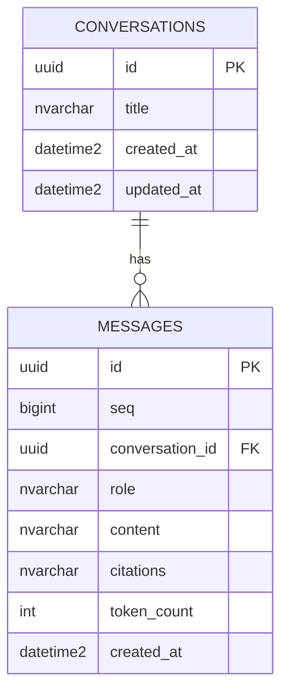

# Database design — project database

_The project's **own** Azure SQL Database (created before any model work — root `CLAUDE.md` →
"What you cannot do"; there is no local database). External databases go in
[`external-systems.md`](external-systems.md), not here._

## Overview

- **Azure resource:** Azure SQL Database in resource group `rg-ai-dev` (`dev`); already created —
  server/database names are in the project's `.env`, not recorded here. `staging` / `prod` are not
  defined yet (`ARCHITECTURE.md` B8 decision 16).
- **Access from `apps/api`:** read/write via `DATABASE_URL`.
- **Service tier / SKU:** _not recorded — add it once known (decides whether `ONLINE` index builds
  are available)._
- **Conventions:** UUID primary keys (`UNIQUEIDENTIFIER`), `created_at`/`updated_at` with server
  defaults, snake_case table/column names, a length on every string column, constraints named by
  the template's naming convention (`app/db/base.py`)

## Entity diagram

## Tables

### `conversations`

| Column       | Type               | Null | Default | Notes                                                                       |
| ------------ | ------------------ | ---- | ------- | --------------------------------------------------------------------------- |
| `id`         | `uniqueidentifier` | no   | `gen`   | PK                                                                          |
| `title`      | `nvarchar(200)`    | no   |         | default "New conversation", else the first question cut to 200              |
| `created_at` | `datetime2(3)`     | no   | now     |                                                                             |
| `updated_at` | `datetime2(3)`     | no   | now     | the list is sorted by it; bumped whenever a message is stored (decision 11) |

- **Indexes:** PK; `updated_at` descending (for the newest-first list) — to confirm at migration time.
- **Foreign keys:** none.
- **PII / retention:** titles can echo a user's first question; kept indefinitely, no purge job.
- **Expected volume:** low (internal team) — not yet estimated.

### `messages`

| Column            | Type               | Null | Default  | Notes                                                     |
| ----------------- | ------------------ | ---- | -------- | --------------------------------------------------------- |
| `id`              | `uniqueidentifier` | no   | `gen`    | PK                                                        |
| `seq`             | `bigint`           | no   | identity | `IDENTITY(1,1)`, unique — the thread order (decision 12)  |
| `conversation_id` | `uniqueidentifier` | no   |          | FK → `conversations.id` (`NO ACTION`), indexed            |
| `role`            | `nvarchar(20)`     | no   |          | `CHECK (role IN ('user','assistant'))`                    |
| `content`         | `nvarchar(max)`    | no   |          |                                                           |
| `citations`       | `nvarchar(max)`    | yes  |          | JSON, `CHECK (citations IS NULL OR ISJSON(citations)=1)`  |
| `token_count`     | `int`              | yes  |          |                                                           |
| `created_at`      | `datetime2(3)`     | no   | now      | informational; threads are ordered by `seq` (decision 12) |

- **Indexes:** PK; unique on `seq`; `conversation_id` (+ `seq` for thread reads).
- **Foreign keys:** `conversation_id` → `conversations.id`, `NO ACTION` (no delete in this release).
- **PII / retention:** message content may contain personal data; kept indefinitely; **never logged**
  (telemetry is content-free). Conversations are shared — no owner column until auth lands.
- **Expected volume:** low — not yet estimated.

## Migration notes

- No migration has been authored or applied. The first revision creates both tables; the
  `migration-author` agent autogenerates against the **dev** database and the migration pipeline
  (or a named human) applies it.
- Nothing outside Alembic is needed (no extensions, roles or seed data).
